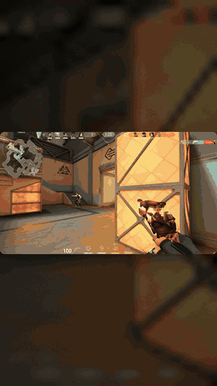
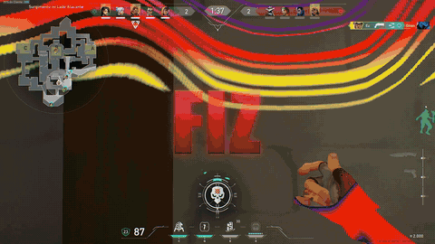
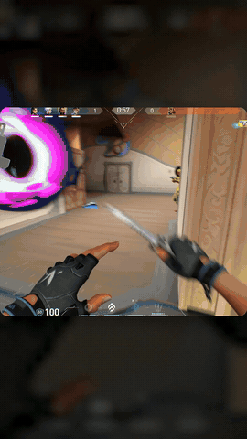
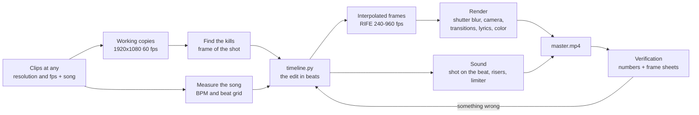
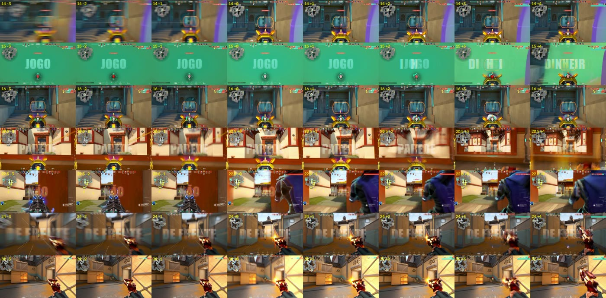

# On-beat gameplay edits, made by Claude Code

[Português](README.md) | **English**

A [Claude Code](https://docs.claude.com/en/docs/claude-code) skill that turns Valorant, CS2 or other FPS clips and a song into an edit ready for TikTok, Reels or Shorts. It puts every kill on the beat, does smooth slow motion with AI interpolation, places transitions on the song's bass or on the rhythm of the kills (your choice), adds short zooms on kills and words from the lyrics on screen, and even delivers the cover image.

It doesn't use a video editor. Claude writes the edit in a Python file (`timeline.py`), a custom pipeline builds every frame, and ffmpeg only reads and writes the videos.

| Default style, vertical (the whole game on screen) | Default style, horizontal, with lyrics | "Window" style (on request only) |
|---|---|---|
|  |  |  |

*The GIFs are 30 fps and 480 px; the real videos come out at 60 fps and full resolution.*

## What you need

| Item | Details |
|---|---|
| Windows 10/11 | Windows only for now: the skill's commands use Git Bash ([Git for Windows](https://git-scm.com/download/win): `winget install Git.Git`) and PowerShell |
| [Claude Code](https://docs.claude.com/en/docs/claude-code) | Runs the skill |
| Model | **Claude Opus 5.5 with thinking at `max` (recommended).** `xhigh` also works, but performs worse |
| GPU with Vulkan | Used for interpolation (RIFE). NVIDIA, AMD or Intel with an up-to-date driver works; CUDA is not needed. Tested on a GTX 1650 4 GB, Ryzen 5 5500, 16 GB of RAM. Laptop with two GPUs: the skill explains how to pick the dedicated one. With no usable GPU it warns you; it can run on the CPU, but about 15 times slower (hours for a 30 s edit) |
| [ffmpeg](https://www.gyan.dev/ffmpeg/builds/) | `winget install Gyan.FFmpeg` |
| [uv](https://docs.astral.sh/uv/) | Creates the project's Python 3.11: `winget install astral-sh.uv` |
| Recordings at any resolution, frame rate and format | 1080p, 1440p, 4K, 4:3 stretched, ultrawide; 30 to 240 fps; H.264, HEVC, AV1; .mp4, .mkv, .mov, .ts; OBS with multiple audio tracks (uses track 1); HDR (converted to SDR) (ShadowPlay, Outplayed, OBS, Medal). 60 fps or higher is ideal: at 30 fps half the frames have to be invented. Vertical phone clips come in with black bars on the sides. Can be short clips or raw recordings a few minutes long |
| Disk space | 7 to 13 GB per video for the interpolated frames (can be deleted afterwards). Add the size of the converted copies when clips are not 1920x1080 at 60 fps, or are on another drive (then they are copied, not linked). Lyrics on screen: about 3 GB more, one time only (the environment that separates the vocals and the two alignment models) |

## Install

In PowerShell:

```powershell
git clone https://github.com/gustavomenani/editing-gameplay-montages.git
cd editing-gameplay-montages
powershell -ExecutionPolicy Bypass -File .\install.ps1
```

In Git Bash: `bash install.sh`.

The script copies the skill to `~/.claude/skills/editing-gameplay-montages`. If a copy was already there, it is saved as `editing-gameplay-montages.backup-<date>` and the path is shown on screen. Then it checks, in Portuguese, what your computer needs (Git for Windows, uv, ffmpeg, a GPU with Vulkan, the Impact font, disk space) and shows the exact `winget` command for anything missing. Nothing is installed unless you ask. To have the script run the winget commands for you, use `-Instalar` (`--instalar` in Git Bash). After installing something, close and reopen the terminal.

**To update:** `git pull` in the cloned folder and run `install.ps1` again. The installed skill is not edited while you make videos: what Claude learns in a project goes into that project's `LEIAME.md` (section "Lições para a skill", "lessons for the skill"), and the skill only changes when you ask ("atualiza a skill", "update the skill"), through the repository. That's why you can update over it without losing anything.

Claude installs the rest (venv, Python dependencies, RIFE model) on its own in the project folder. Before starting, it runs a diagnostic (`doctor.py`) that tests everything, including RIFE on your GPU, and ends with `PRONTO` (ready) or `FALTA: ...` (missing) and what to do.

<details><summary>Manual install, without the script</summary>

```bash
mkdir -p ~/.claude/skills
cp -r editing-gameplay-montages/skills/editing-gameplay-montages ~/.claude/skills/
```

To update this way, delete the old folder before copying the new one: the installed skill doesn't store anything of yours.

</details>

## How to ask for the video

1. Put the clips and the song in a folder. **Recommended:** also add a reference video, an edit you liked (downloaded from TikTok or YouTube). With it the skill copies the cuts, the rhythm, the effects and the text: when there is a reference, the edit is always built from it, and always on the rhythm of the music.
2. Open Claude Code in that folder and ask for the edit, in your own words:

```text
make a tiktok edit with these clips and this song
```

3. The skill first replies with a briefing: it asks about the format, length, intensity, where the transitions land, whether you want the lyrics on screen (paste the lyrics in your reply) and a cover, which plays open and close the edit, which part of the song and which game, and gives tips to get a better result. Answer everything in a single message. Whatever you leave blank, it decides on its own.
4. From then on it doesn't ask anything else. As soon as the edit is assembled, you get a **quick preview** (`_previa.mp4`, in under a minute): no effects and with deliberately choppy slow motion, but with the order, the cuts, the kills on the beat, the lyrics and the music. If you want to change something, just say so before the final video, which is ready after interpolation and rendering.
5. Got the video? Say in your own words what to change ("it stutters here", "that kill is off the beat", "darker", "remove this kill"). Each version comes out as a new file.

If your request already says everything, it skips the briefing:

```text
edit these valorant clips with the SAME EDITING as this video "referencia.mp4", 30 seconds, with the song's lyrics on screen, opening with the ace
```

After that you keep adjusting like you would with a human editor: "the slow motion stutters", "sync the lyrics better", "remove that raze kill". Each version comes out as a new file (`_v1`, `_v2`, ...) next to the clips, and the previous ones stay.

Times measured on 37 to 46 second videos (GTX 1650): 30 to 55 minutes of interpolation and 12 to 16 minutes of rendering, both in the background. A tweak that doesn't touch the cuts only needs a new render.

## How it works

The skill's core idea: **Claude can't see or hear the video, so nothing is done by eye.** Frames are read by number, beats are measured on the waveform, each kill is pinned to the frame of the shot, and every render is judged by numbers and by images it reads.



1. **Any recording becomes the working format.** 1440p, 4K, 4:3 stretched or ultrawide, 30 to 240 fps: every clip becomes 1920x1080 at 60 fps. When an original frame falls on the right instant, it is used untouched (120 and 240 fps). When it doesn't, RIFE creates the frame at the exact instant (144 fps, for example). No frame is ever repeated, and the sound stays aligned to the frame (0.000 ms of measured difference).
2. **Frames by number.** Cutting with `-ss` and `fps=60` in ffmpeg duplicated 1 frame in every 3 (that's what people feel as "fps drops"). Every frame is read by its index.
3. **Kills in any game, and the right ones.** The skill tracks each kill feed line by its color: it keeps only your kills (discards teammates' kills and your deaths) and never counts the same line twice. Looking back, it finds the shot that killed: the last shot where the ammo went down before the line appeared, never the first shot of a spray. The frame that goes on the beat is the frame of that **shot**, and it is measured again in the images (the step in the ammo counter, the start of the muzzle flash): one wrong frame is 16.7 ms of desync, and a guessed frame doesn't pass. A kill hidden behind a wall, smoke or flash is flagged and left out. Each kill gets a score (headshot, multi-kill, clean shot), and the same play never goes in twice, even when the folder has the full recording and clips cut from it. In Valorant, measured on 26 clips: the right shot on 62 of the 66 kills in two real edits, and the other 4 within 3 frames. There are profiles for Valorant, CS2 and a generic one for any other game.
4. **Music.** It measures the attack of every drum hit (a single definition, with an error of about 2 ms on kick, snare and hi-hat) and checks the BPM: a BPM that doesn't fit the attacks is rejected, and the skill says which one fits best. It also says honestly whether a constant grid works (live bands, swing and drifting tempo don't: then each event goes on the timing of its own hit). Every kill, cut, bump and boom is placed on the **measured attack** of the hit, never on the grid time. Transitions go where you chose in the briefing: **on the rhythm of the kills** (the default, as in the model edit: a cut right before each kill, on a beat line) or **on the bass** (subtler, with fewer cuts). On the bass, the skill checks that no transition landed off the kick. Songs in m4a or mp3 are converted once to flac, because audio cuts in those formats are off by 8 to 40 ms.
5. **The edit is code.** `timeline.py` says, in musical beats, which frame of which clip appears at each moment. Every image lands on an exact frame (the cut and the muzzle flash one frame before the beat: an image one frame ahead of the sound looks in sync, behind it looks late, measured on the reference) and every sound at the exact instant of the beat. Speed ramps are smooth curves between anchors.
6. **Real slow motion.** RIFE creates in-between frames (240 fps everywhere, 960 fps where it's slow). Each final frame is the average of the subframes within the shutter time, which gives real motion blur and no stutter.
7. **Sound.** The shot of each kill is measured in the clip's own audio, down to the sample, and placed exactly on the attack of the beat; the finished video's audio matches the song within 0.1 ms. Then come risers before the drops and a limiter (with its delay compensated). AAC is encoded with PNS, TNS and intensity stereo turned off, because with them three versions came out clipping.
8. **Verification and delivery gate.** Before delivering, the skill measures repeated frames, stutters, jumps, loudness and peak. For each kill it measures on which frame the muzzle flash appears: whole on the shot frame and absent on the one before. Finally, a gate (`gate.py`) refuses delivery while there is any error: a sped-up section, a frozen frame, a kill off the beat or without a shot, clipping audio, a render from an old timeline. Alongside it runs an independent audit of the finished file (`syncaudit.py`): video timestamps, sound against the song, the frame of each cut, flash, effect and word; it runs on the master and again on the copy that goes to upload. A problem you accept is noted in the project, but sound off the song, drift, cuts off the frame and irregular timestamps can never be accepted.



## The default style: the model edit

The best edit ever made with the skill (the one the author considers the best synced and best edited) became the default. Its patterns are in `model-edit.md`, written relative to the music (beats, measured drum attacks, sections of the song), not as copied timestamps: **the song you send decides where everything lands.** The intro sits on your song's break, the bullet time kill lands on its drop, the ace on the last sung line. With or without a reference video, the edit comes out like this (with a reference, it also copies its look and cut rhythm):

| | |
|---|---|
| Format | Vertical 1080x1920 by default, with the **whole** game in a window over a blurred background (minimap and kill feed show, nothing is cropped), or horizontal 1920x1080 full screen; 60 fps |
| Structure | Intro with slow motion kills over the song's break, bullet time with a white flash landing on the drop, a kill roughly every second on the measured drum attacks, a second bullet time where the drums breathe, the ace on the last line, fades out through the shadows first |
| Cuts | Hard cut with 5 frames of blur (whip, zoom, spin) 14 frames before each kill, on a beat line, so the enemy shows up before dying; or on the attack of the song's bass, if you ask |
| Speed | Nothing plays faster than real time (unless you ask for "velocity"); after the shot the slow motion lasts until the body drops, it never cuts the death |
| Accents | By kill level: radial burst, RGB split, light rays, one inverted frame on the big kills (drop, the strongest snare, the ace); light pulses on drum attacks between kills |
| Sound | Each kill's shot on the attack of the beat (measured down to the sample), sub bass under each kill, swish on cuts, booms on big kills, risers before the drop |
| Color | Saturated, with a visible vignette (`LOOK = "modelo"`) |
| Text | Optional: the lyrics word by word, each one on the attack where it's sung (the first letter one frame early, the whole word on it; aligned on the song's isolated vocals), translucent, always in the exact center of the screen, at a size you can read at a glance without covering the game |
| Extra | Cover with the title, vertical or horizontal |

The old "house" style (a window showing only 2/3 of the game's width, transitions that move both clips, a pulsing background) is still available if you ask for "estilo janela" or "estilo house" ("window style" or "house style"), but it's no longer the default.

## Editing options

Say how you want the edit in your own words. The skill turns that into render settings. Anything you don't ask for stays as in the model edit.

| You ask for | What changes |
|---|---|
| "subtle", "intense", "maxed out" | All effects together, from lightest to heaviest |
| "warm color", "cool color", "teal & orange", "black and white", "vivid colors" (light or strong) | Color grade of the whole video |
| "vignette", "more saturated", "more contrast", "grain", "glow" | Image finish, from 0 (none) to strong |
| "no shake", "more zoom on kills", "flash on kills", "RGB split" | Kill accents |
| "cinema bars", "harder cuts", "more blur on cuts" | Cuts and format (bars only in horizontal) |
| "transitions on the bass" or "on the rhythm of the kills", "more slow motion", "vertical" or "horizontal" | Rhythm and format |

**The reference is still what makes the biggest difference.** With an example edit in the folder, the skill copies its cuts, rhythm, effects and text, and the options above adjust whatever you want different.

## Structure

```text
skills/editing-gameplay-montages/
  SKILL.md              entry point: briefing, styles, rules, step by step
  model-edit.md         the patterns of the best edit (rhythm, structure, accents, sound), fitted to the requester's song
  pipeline.md           install, scripts, timings, how to run long jobs
  edit-design.md        "window" style (house, on request only): sequence, ramps, effects, transitions, sound
  reference-style.md    the default style: copying a reference, timeline generator, lyrics, cover, raw recordings
  verification.md       how to judge a render without watching it
  pitfalls.md           symptom -> cause -> fix for everything that has gone wrong
  tools-research.md     CapCut, Resolve, Remotion, MCPs: what was compared
  scripts/              Python pipeline (input at any resolution/fps, render, sound, music, kills, checks)
  scripts/games/        game profiles for finding kills (valorant, cs2, generic)
  scripts/refstyle/     default style files (vertical/horizontal render, lyrics, reference analyzer, cover)
  models/rife-v4.25/    interpolation network (ncnn/Vulkan)
```

## Limitations

- The final video comes out at 1080x1920 (vertical) or 1920x1080 (horizontal), at 60 fps.
- Automatic kill detection was measured in Valorant: it found 26 of the 27 reference kills and got the exact shot frame right in 22 of 23. The CS2 profile was built from the game's HUD files, but hasn't been tested on a real recording yet. The generic profile finds the kill feed lines (26 of 27 in the same test), but without your kills' color and without the game's ammo counter, it gets the shot frame wrong in sprays. For another game, Claude creates its profile by looking at a frame. In any game it checks every kill on the review sheets before using it.
- In vertical, the whole game fills a band in the middle of the screen (about 1/3 of the height), with the blurred background around it. A vertical reference that crops the game to fill the screen is not copied on this point, because the crop becomes a zoom that blurs the game and hides the minimap and kill feed. The default vertical style was validated on a full 32 s edit (16 kills, no repeated or stuttering frames).
- The shell commands are for Windows (Git Bash and PowerShell).
- Claude measures everything, but doesn't watch. Feel, intensity and mixing are for you to judge.
- Lyrics on screen only use lines you pasted or that were confirmed on a lyrics page, because speech recognition gets half a trap verse wrong. With the lyrics in hand, the skill separates the vocals from the music, aligns each word to them with two models and places each one on the vocal attack measured on the isolated vocals (measured: vocal cuts 5 ms apart give words at most 2.4 ms apart), and a numeric audit checks each word against its attack; the ones flagged as doubtful get a zoom sheet for you to check before the render.
- TikTok may convert 60 fps uploads to 30 fps if the high quality option is turned off (not officially confirmed).

## Contributing

The project is open. Issues and pull requests are welcome, especially for:

- validating the CS2 profile on real recordings and creating profiles for other games (Fortnite, Apex) for kill detection;
- full edits from other people, with other songs, to fine-tune the default style;
- equivalent commands for Linux and macOS.

Every pipeline change should come with the measurement that justifies it (`check.py`, sync sheets), following the skill's principle: nothing by eye.

## Credits and license

- Scripts and documentation: [MIT](LICENSE).
- RIFE v4.25 interpolation model: [Practical-RIFE](https://github.com/hzwer/Practical-RIFE) (hzwer, MIT), converted to ncnn in [rife-ncnn-vulkan](https://github.com/TNTwise/rife-ncnn-vulkan) (MIT). Python binding: `rife-ncnn-vulkan-python-tntwise`.
- The repository doesn't include music or recordings. The rights to the songs and clips you use are yours to sort out.
