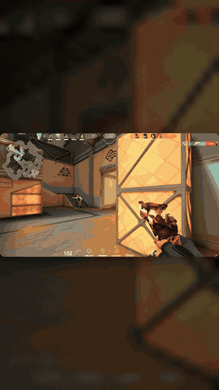
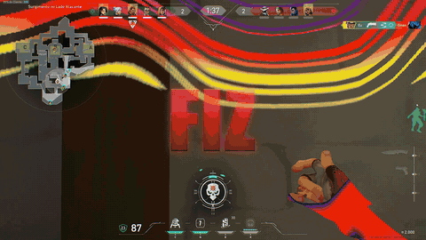
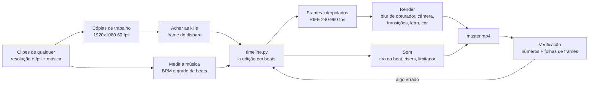

# Edit de gameplay no beat, feito pelo Claude Code

Uma skill do [Claude Code](https://docs.claude.com/en/docs/claude-code) que transforma clipes de Valorant, CS2 ou outro FPS e uma música num edit pronto para TikTok, Reels ou Shorts. Ela coloca cada kill no beat, faz slow motion suave com interpolação por IA, transições no grave da música ou no ritmo das kills (você escolhe), zooms curtos nas kills e palavras da letra na tela, e entrega até a capa.

Não usa editor de vídeo. O Claude escreve a edição num arquivo Python (`timeline.py`), um pipeline próprio monta cada frame, e o ffmpeg só lê e grava os vídeos.

| Estilo padrão, vertical (o jogo inteiro na tela) | Estilo padrão, horizontal, com letra | Estilo "janela" (só a pedido) |
|---|---|---|
|  |  |  |

*Os GIFs têm 30 fps e 480 px; os vídeos de verdade saem em 60 fps e em resolução cheia.*

## O que você precisa

| Item | Detalhe |
|---|---|
| Windows 10/11 | Por enquanto só Windows: os comandos da skill usam Git Bash ([Git for Windows](https://git-scm.com/download/win): `winget install Git.Git`) e PowerShell |
| [Claude Code](https://docs.claude.com/en/docs/claude-code) | Quem roda a skill |
| Modelo | **Claude Opus 5.5 com pensamento no `max` (recomendado).** No `xhigh` também funciona, mas com desempenho inferior |
| Placa de vídeo com Vulkan | Usada na interpolação (RIFE). Serve NVIDIA, AMD ou Intel com o driver em dia; não precisa de CUDA. Testado numa GTX 1650 4 GB, Ryzen 5 5500, 16 GB de RAM. Notebook com duas placas: a skill explica como escolher a dedicada. Sem placa usável ela avisa; dá para rodar na CPU, mas é umas 15 vezes mais lento (horas para um edit de 30 s) |
| [ffmpeg](https://www.gyan.dev/ffmpeg/builds/) | `winget install Gyan.FFmpeg` |
| [uv](https://docs.astral.sh/uv/) | Cria o Python 3.11 do projeto: `winget install astral-sh.uv` |
| Gravações de qualquer resolução, taxa e formato | 1080p, 1440p, 4K, 4:3 esticado, ultrawide; de 30 a 240 fps; H.264, HEVC, AV1; .mp4, .mkv, .mov, .ts; OBS com várias faixas de áudio (usa a faixa 1); HDR (convertido para SDR) (ShadowPlay, Outplayed, OBS, Medal). O ideal é 60 fps ou mais: a 30 fps metade dos frames tem que ser inventada. Clipe vertical de celular entra com barras pretas dos lados. Pode ser clipe curto ou gravação crua de alguns minutos |
| Espaço em disco | De 7 a 13 GB por vídeo para os frames interpolados (dá para apagar depois). Some o tamanho das cópias convertidas quando os clipes não são 1920x1080 a 60 fps, ou estão em outro disco (aí eles são copiados, não linkados). Letra na tela: mais uns 3 GB uma vez só (o ambiente que separa a voz e os dois modelos de alinhamento) |

## Instalar

No PowerShell:

```powershell
git clone https://github.com/gustavomenani/editing-gameplay-montages.git
cd editing-gameplay-montages
powershell -ExecutionPolicy Bypass -File .\install.ps1
```

No Git Bash: `bash install.sh`.

O script copia a skill para `~/.claude/skills/editing-gameplay-montages`. Se já havia uma cópia, ela é guardada em `editing-gameplay-montages.backup-<data>`, com as anotações que o Claude tenha feito, e o caminho aparece na tela. Depois ele confere, em português, o que o computador precisa (Git for Windows, uv, ffmpeg, placa de vídeo com Vulkan, fonte Impact, espaço em disco) e mostra o comando exato do `winget` para o que faltar. Nada é instalado sem você pedir. Para o script rodar os comandos do winget por você, use `-Instalar` (`--instalar` no Git Bash). Depois de instalar algo, feche e abra o terminal.

**Para atualizar:** `git pull` na pasta clonada e rode o `install.ps1` de novo.

O resto (venv, dependências Python, modelo RIFE) o Claude instala sozinho na pasta do projeto. Antes de começar, ele roda um diagnóstico (`doctor.py`) que testa tudo, inclusive o RIFE na sua placa de vídeo, e termina com `PRONTO` ou `FALTA: ...` e o que fazer.

<details><summary>Instalação manual, sem o script</summary>

```bash
mkdir -p ~/.claude/skills
cp -r editing-gameplay-montages/skills/editing-gameplay-montages ~/.claude/skills/
```

Antes de atualizar assim, guarde uma cópia de `~/.claude/skills/editing-gameplay-montages`, porque o Claude anota nela o que aprende nos seus projetos.

</details>

## Como pedir o vídeo

1. Coloque numa pasta os clipes e a música. **Recomendado:** coloque também um vídeo de referência, um edit que você curtiu (baixado do TikTok ou do YouTube). Com ele a skill copia os cortes, o ritmo, os efeitos e o texto.
2. Abra o Claude Code nessa pasta e peça o edit, do seu jeito:

```text
faz um edit pro tiktok com esses clipes e essa música
```

3. A skill responde primeiro com um briefing: pergunta o formato, a duração, a intensidade, onde caem as transições, se quer a letra na tela (cole a letra na resposta) e a capa, quais jogadas abrem e fecham, qual parte da música e qual jogo, e dá dicas para o resultado ficar melhor. Responda tudo numa mensagem só. O que você deixar em branco ela decide sozinha.
4. Daí em diante ela não pergunta mais nada. Assim que o edit está montado, você recebe uma **prévia rápida** (`_previa.mp4`, em menos de um minuto): sem efeitos e com a câmera lenta engasgada de propósito, mas com a ordem, os cortes, as kills no beat, a letra e a música. Se quiser mudar algo, é só falar antes do vídeo final, que fica pronto depois da interpolação e do render.
5. Recebeu o vídeo? Diga do seu jeito o que mudar ("tá travado aqui", "a kill tá fora do beat", "mais escuro", "tira essa kill"). Cada versão sai como um arquivo novo.

Se o seu pedido já disser tudo, ela pula o briefing:

```text
edita esses clipes de valorant com a MESMA EDIÇÃO desse vídeo "referencia.mp4", 30 segundos, com a letra da música na tela, abrindo com o ace
```

Depois é ir ajustando como faria com um editor humano: "o slow motion tá travado", "sincroniza melhor as letras", "tira aquela kill da raze". Cada versão sai como um arquivo novo (`_v1`, `_v2`, ...) ao lado dos clipes, e as anteriores ficam.

Tempos medidos em vídeos de 37 a 46 segundos (GTX 1650): de 30 a 55 minutos de interpolação e de 12 a 16 minutos de render, os dois em segundo plano. Um ajuste que não mexe nos cortes só precisa de um render novo.

## Como funciona

A ideia central da skill: **o Claude não consegue ver nem ouvir o vídeo, então nada é feito "no olho".** Os frames são lidos pelo número, os beats são medidos na forma de onda, cada kill é presa ao frame do disparo, e cada render é julgado por números e por imagens que ele lê.



1. **Qualquer gravação vira o formato de trabalho.** 1440p, 4K, 4:3 esticado ou ultrawide, de 30 a 240 fps: cada clipe vira 1920x1080 a 60 fps. Quando um frame original cai no instante certo, ele é usado sem mexer (120 e 240 fps). Quando não cai, o RIFE cria o frame no instante exato (144 fps, por exemplo). Nunca se repete frame, e o som fica alinhado ao frame (0,000 ms de diferença medida).
2. **Frames pelo número.** Cortar com `-ss` e `fps=60` no ffmpeg duplicava 1 frame em cada 3 (era isso que o pessoal sente como "quedas de fps"). Todo frame é lido pelo índice.
3. **Kills em qualquer jogo, e as certas.** A skill acompanha cada linha do kill feed pela cor: fica só com as suas kills (descarta as de aliados e as suas mortes) e não conta duas vezes a mesma linha. Olhando para trás, acha o tiro que matou: o último tiro em que a munição desceu antes da linha aparecer, nunca o primeiro tiro de um spray. O frame que vai no beat é o desse **disparo**. Kill escondida atrás de parede, smoke ou flash fica marcada e não entra. Cada kill ganha uma nota (headshot, multi-kill, tiro limpo), e a mesma jogada nunca entra duas vezes, mesmo quando a pasta tem a gravação inteira e os cortes dela. No Valorant, medido em 26 clipes: o tiro certo em 62 das 66 kills de dois edits reais, e as outras 4 com até 3 frames de diferença. Há perfis de Valorant, CS2 e um genérico para qualquer outro jogo.
4. **Música.** Mede o BPM e refina a grade de beats contra os ataques do bumbo (o primeiro chute costuma vir uns 38 ms adiantado). As kills só vão em bumbo, caixa ou hi-hat forte que foram medidos. As transições vão onde você escolher no briefing: **no ritmo das kills** (o padrão, como no edit modelo: um corte logo antes de cada kill) ou **no grave** (mais fino, com menos cortes). No grave, a skill confere que nenhuma transição caiu fora dele.
5. **A edição é código.** `timeline.py` diz, em beats, qual frame de qual clipe aparece em cada momento. As rampas de velocidade são curvas suaves entre âncoras.
6. **Slow motion de verdade.** O RIFE cria frames intermediários (240 fps em tudo, 960 fps onde está lento). Cada frame final é a média dos subframes no tempo do obturador, o que dá motion blur real e nenhum engasgo.
7. **Som.** Cada tiro é colocado exatamente no beat. Depois vêm risers antes dos drops e um limitador. O AAC é gravado com PNS, TNS e intensity stereo desligados, porque com eles três versões saíram estourando.
8. **Verificação e trava de entrega.** Antes de entregar, a skill mede frames repetidos, travadas, saltos, loudness e pico. Para cada kill ela monta uma folha dos frames −3 a +4: o clarão do tiro não pode aparecer no −1 e precisa começar no +0. Por último, uma trava (`gate.py`) recusa a entrega enquanto houver erro: trecho acelerado, frame congelado, kill fora do beat ou sem tiro, áudio estourando, render de um timeline antigo. Um problema que você aceitar fica anotado no projeto.


## O estilo padrão: o edit modelo

O melhor edit já feito com a skill (o que o autor considera o mais bem sincronizado e bem editado) virou o padrão. Os padrões dele estão em `model-edit.md`, escritos em relação à música (batidas, ataques medidos da bateria, partes da música), e não como tempos copiados: **a música que você manda decide onde cada coisa cai.** A intro fica no break da sua música, a kill em bullet time cai no drop dela, o ace na última frase cantada. Com ou sem vídeo de referência, o edit sai assim (com referência, ele copia também o visual e o ritmo de cortes dela):

| | |
|---|---|
| Formato | Vertical 1080x1920 por padrão, com o jogo **inteiro** numa janela sobre o fundo desfocado (minimapa e kill feed aparecem, nada é cortado), ou horizontal 1920x1080 em tela cheia; 60 fps |
| Estrutura | Intro com kills em câmera lenta sobre o break da música, bullet time com flash branco caindo no drop, uma kill mais ou menos a cada segundo nos ataques medidos da bateria, um segundo bullet time onde a bateria respira, o ace na última frase, escurece pelas sombras primeiro |
| Cortes | Corte seco com 5 frames de blur (whip, zoom, giro) 14 frames antes de cada kill, para o inimigo aparecer antes de morrer; ou no grave da música, se você pedir |
| Velocidade | Nada passa mais rápido que o tempo real (a não ser que você peça "velocity"); depois do tiro a câmera lenta dura até o corpo cair, nunca corta a morte |
| Acentos | Por nível de kill: explosão radial, RGB split, raios de luz, um frame invertido nas kills grandes (drop, a caixa mais forte, o ace); pulsos de luz nos ataques da bateria entre as kills |
| Som | Tiro de cada kill no beat, sub grave sob cada kill, swish nos cortes, booms nas kills grandes, risers antes do drop |
| Cor | Saturada, com vinheta visível (`LOOK = "modelo"`) |
| Texto | Opcional: palavra por palavra da letra, cada uma no instante em que é cantada (alinhada na voz isolada da música), translúcida, sempre no centro exato da tela, num tamanho que se lê de relance sem tampar o jogo |
| Extra | Capa com o título, vertical ou horizontal |

O antigo estilo "house" (janela que mostra só 2/3 da largura do jogo, transições que movem os dois clipes, fundo que pulsa) continua disponível se você pedir "estilo janela" ou "estilo house", mas deixou de ser o padrão.

## Opções de edição

Fale do seu jeito como quer o edit. A skill traduz para os ajustes do render. Qualquer coisa que você não pedir fica como no edit modelo.

| Você pede | O que muda |
|---|---|
| "suave", "intensa", "no máximo" | Todos os efeitos juntos, do mais leve ao mais pesado |
| "cor quente", "cor fria", "teal & orange", "preto e branco", "cores vivas" (leve ou forte) | Gradação de cor do vídeo inteiro |
| "vinheta", "mais saturado", "mais contraste", "granulado", "glow" | Acabamento da imagem, de 0 (sem) até forte |
| "sem tremor", "mais zoom nas kills", "flash nas kills", "RGB split" | Acentos nas kills |
| "barras de cinema", "cortes mais secos", "mais borrão nos cortes" | Cortes e formato (barras só no horizontal) |
| "transições no grave" ou "no ritmo das kills", "mais câmera lenta", "vertical" ou "horizontal" | Ritmo e formato |

**A referência continua sendo o que mais faz diferença.** Com um edit de exemplo na pasta, a skill copia os cortes, o ritmo, os efeitos e o texto dele, e as opções acima ajustam o que você quiser diferente.

## Estrutura

```text
skills/editing-gameplay-montages/
  SKILL.md              ponto de entrada: briefing, estilos, regras, passo a passo
  model-edit.md         os padrões do melhor edit (ritmo, estrutura, acentos, som), encaixados na música de quem pede
  pipeline.md           instalação, scripts, tempos, como rodar jobs longos
  edit-design.md        estilo "janela" (house, só a pedido): sequência, rampas, efeitos, transições, som
  reference-style.md    o estilo padrão: copiar uma referência, gerador de timeline, letra, capa, gravação crua
  verification.md       como julgar um render sem assistir
  pitfalls.md           sintoma -> causa -> solução de tudo que já deu errado
  tools-research.md     CapCut, Resolve, Remotion, MCPs: o que foi comparado
  scripts/              pipeline em Python (entrada de qualquer resolução/fps, render, som, música, kills, checagens)
  scripts/games/        perfis de jogo para achar kills (valorant, cs2, generic)
  scripts/refstyle/     arquivos do estilo padrão (render vertical/horizontal, letra, analisador de referência, capa)
  models/rife-v4.25/    rede de interpolação (ncnn/Vulkan)
```

## Limitações

- O vídeo final sai em 1080x1920 (vertical) ou 1920x1080 (horizontal), a 60 fps.
- A detecção automática de kills foi medida no Valorant: achou 26 das 27 kills de referência e acertou o frame exato do disparo em 22 de 23. O perfil de CS2 foi montado a partir dos arquivos de HUD do jogo, mas ainda não foi testado em gravação real. O perfil genérico acha as linhas do kill feed (26 das 27 no mesmo teste), mas, sem a cor das suas kills e sem o contador de munição do jogo, erra o frame do disparo em sprays. Para outro jogo, o Claude cria o perfil dele olhando um frame. Em qualquer jogo ele confere cada kill nas folhas de revisão antes de usar.
- No vertical, o jogo inteiro ocupa uma faixa no meio da tela (cerca de 1/3 da altura), com o fundo desfocado em volta. Uma referência vertical que corta o jogo para encher a tela não é copiada nesse ponto, porque o corte vira um zoom que borra o jogo e esconde minimapa e kill feed. O estilo padrão vertical foi validado num edit completo de 32 s (16 kills, nenhum frame repetido ou travado).
- Os comandos de shell são de Windows (Git Bash e PowerShell).
- O Claude mede tudo, mas não assiste. Sensação, intensidade e mixagem quem julga é você.
- A letra na tela só usa linhas que você colou ou que foram confirmadas numa página de letras, porque o reconhecimento de voz erra metade de um verso de trap. Com a letra em mãos, a skill separa a voz da música e alinha cada palavra nela com dois modelos (medido: mediana de 5 ms de diferença para a sincronia aprovada à mão), e mostra uma folha para conferir antes do render.
- O TikTok pode converter uploads de 60 fps para 30 fps se a opção de alta qualidade estiver desligada (não confirmado oficialmente).

## Contribuir

O projeto é aberto. Issues e pull requests são bem-vindos, principalmente para:

- validar o perfil de CS2 em gravações reais e criar perfis de outros jogos (Fortnite, Apex) para a detecção de kills;
- edits completos de outras pessoas, com outras músicas, para afinar o estilo padrão;
- comandos equivalentes para Linux e macOS.

Toda mudança no pipeline deve vir com a medição que a justifica (`check.py`, folhas de sincronia), seguindo o princípio da skill: nada no olho.

## Créditos e licença

- Scripts e documentação: [MIT](LICENSE).
- Modelo de interpolação RIFE v4.25: [Practical-RIFE](https://github.com/hzwer/Practical-RIFE) (hzwer, MIT), convertido para ncnn em [rife-ncnn-vulkan](https://github.com/TNTwise/rife-ncnn-vulkan) (MIT). Binding Python: `rife-ncnn-vulkan-python-tntwise`.
- O repositório não traz música nem gravações. Os direitos das músicas e dos clipes que você usar são seus para resolver.
